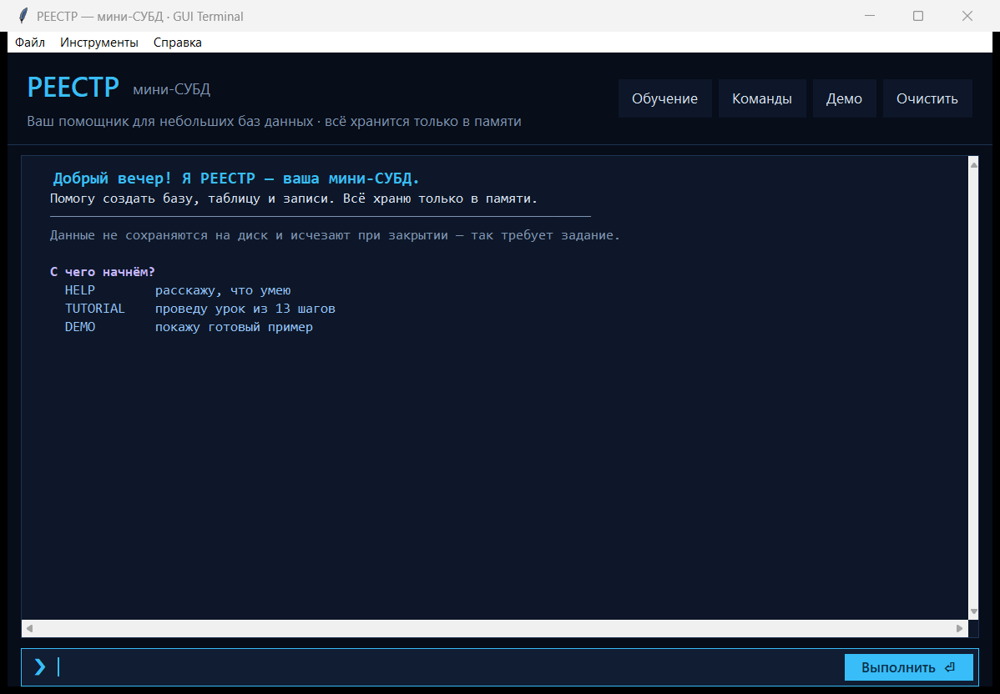
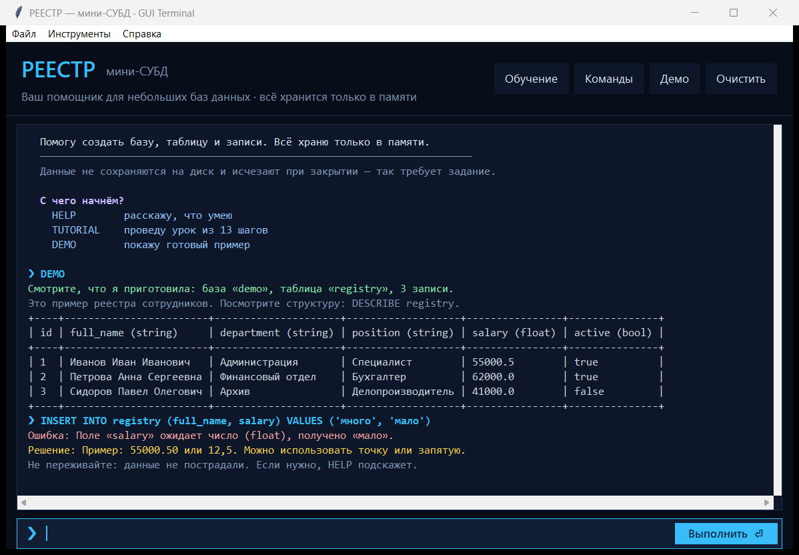
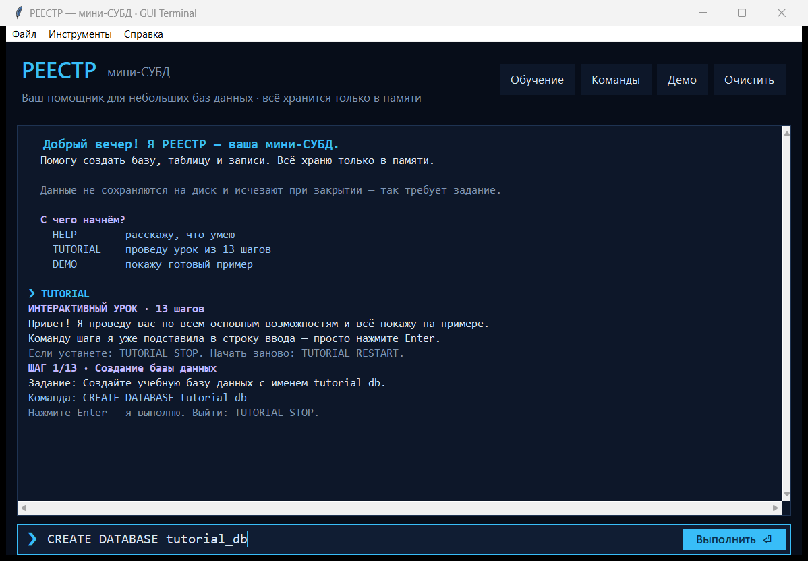
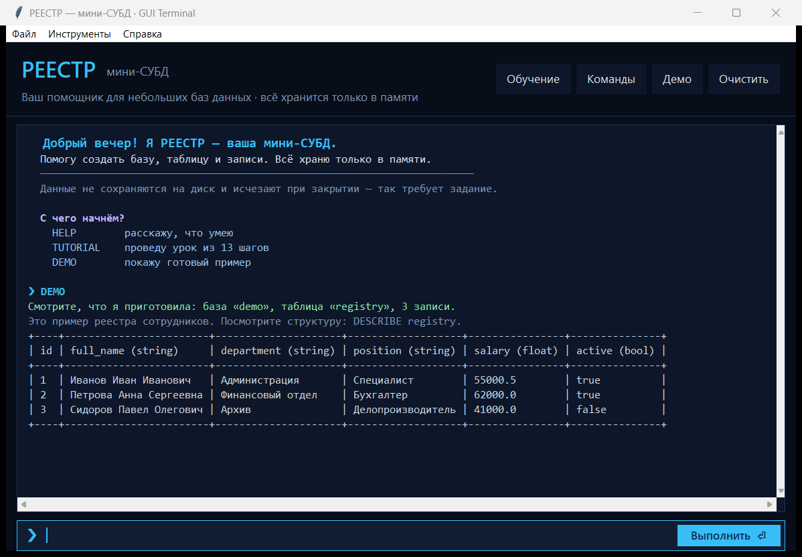

# РЕЕСТР — учебная СУБД с GUI-терминалом

Учебный командный проект по специальности **09.02.07 «Информационные системы и
программирование»**. Приложение реализует упрощённую систему управления базами
данных для внутреннего использования: базы данных, таблицы, поля и записи
хранятся **только в оперативной памяти**, сторонние библиотеки не используются.



## Возможности

* создание, просмотр, выбор и удаление баз данных;
* создание таблиц с уникальными именами и полями типов `string`, `int`,
  `float`, `bool`;
* просмотр списка таблиц и структуры конкретной таблицы;
* добавление и удаление полей, проверка дубликатов и корректности имён;
* добавление, просмотр, изменение и удаление записей по `id`;
* строгая валидация типов и понятные сообщения об ошибках с решением;
* интерактивный урок из 13 шагов, который сам подставляет команды;
* дружелюбные сообщения: программа здоровается, подбадривает и объясняет
  ошибки человеческим языком;
* демонстрационная база `DEMO` для быстрого показа;
* тёмный GUI-терминал: история команд, автодополнение, копирование вывода,
  меню и кнопки быстрого доступа.

## Запуск

Требуется **Python 3.10+** с модулем `tkinter` (входит в стандартную установку
Python для Windows). Устанавливать пакеты не нужно.

```powershell
python main.py
```

Или двойным щелчком по `run.pyw` — приложение откроется без окна консоли.
Также можно запустить `start.bat`.

При первом запуске введите `HELP` или `TUTORIAL`. Для быстрой демонстрации
введите `DEMO`.

## Команды

### Базы данных

| Команда | Назначение |
|---|---|
| `CREATE DATABASE <имя>` | создать базу данных |
| `SHOW DATABASES` | список баз, таблиц и записей |
| `USE <имя>` | выбрать текущую базу |
| `DROP DATABASE <имя> CONFIRM` | удалить базу со всеми данными |

### Таблицы

| Команда | Назначение |
|---|---|
| `CREATE TABLE <имя> (поле:тип, ...)` | создать таблицу |
| `SHOW TABLES` | список таблиц текущей базы |
| `DESCRIBE <таблица>` | структура и количество записей |
| `ALTER TABLE <т> ADD <поле>:<тип>` | добавить поле |
| `ALTER TABLE <т> DROP <поле>` | удалить поле |
| `DROP TABLE <имя> CONFIRM` | удалить таблицу |

### Данные

| Команда | Назначение |
|---|---|
| `INSERT INTO <т> (поля) VALUES (значения)` | добавить запись |
| `SELECT * FROM <т>` | показать все записи |
| `SELECT * FROM <т> WHERE id = N` | показать одну запись |
| `UPDATE <т> SET поле = значение WHERE id = N` | изменить поля записи |
| `DELETE FROM <т> WHERE id = N` | удалить запись |

### Прочее

`HELP [раздел]`, `TUTORIAL`, `TUTORIAL STOP`, `TUTORIAL RESTART`, `DEMO`,
`STATUS`, `CLEAR`, `ABOUT`, `EXIT`. Можно просто написать `ПРИВЕТ`,
`СПАСИБО` или `КАК ДЕЛА` — программа ответит по-человечески.

## Пример работы

```text
CREATE DATABASE demo
CREATE TABLE employees (name:string, age:int, salary:float, active:bool)
INSERT INTO employees (name, age, salary, active)
VALUES ('Иван Петров', 30, 55000.50, true)
SELECT * FROM employees
UPDATE employees SET salary = 60000 WHERE id = 1
DELETE FROM employees WHERE id = 1
```

Строки с пробелами, запятыми и скобками заключаются в кавычки:

```text
INSERT INTO employees (name, age, salary, active)
VALUES ('Иванов, Иван', 30, 55000.50, true)
```

## Типы данных

| Тип | Допустимые значения | Пример |
|---|---|---|
| `string` | любая строка | `'Иван Петров'` |
| `int` | целое число | `42`, `-7` |
| `float` | вещественное число, точка или запятая | `55000.50`, `12,5` |
| `bool` | `true/false`, `1/0`, `да/нет` | `true` |

## Обработка ошибок

Каждая ошибка выводится красным цветом, а следующая строка содержит решение:

```text
Ошибка: Поле «salary» ожидает число (float), получено «мало».
Решение: Пример: 55000.50 или 12,5. Можно использовать точку или запятую.
```

Обрабатываются: дубликаты баз, таблиц, полей и колонок в `INSERT`; неверные
имена; несуществующие объекты и `id`; неверные типы; пропущенные поля;
незакрытые кавычки и скобки; неизвестные команды. Любая ошибка не завершает
приложение.



## Интерактивное обучение



`TUTORIAL` запускает урок из 13 шагов: создание базы, выбор базы, создание
таблицы, просмотр и изменение структуры, две вставки, `SELECT`, `UPDATE`,
`DELETE`, удаление таблицы и базы. Команда шага подставляется в строку
ввода — достаточно нажать `Enter`. Урок проверяет реальное состояние данных,
а не только текст команды.

## Демонстрационные данные



Команда `DEMO` создаёт базу `demo` с таблицей `registry` (реестр сотрудников)
и тремя записями. Удобно для защиты проекта.

## Структура проекта

```text
main.py                 точка входа
run.pyw                 запуск без консоли
start.bat               запуск в Windows
dbms/
  errors.py             исключения с подсказками
  models.py             Field, Table, Database, DatabaseManager
  parser.py             разбор строк, кавычек и скобок
  engine.py             диспетчер команд и валидация
  help_text.py          готовые тексты справки
  render.py             отрисовка таблиц символами
  tutorial.py           интерактивный урок (13 шагов)
  result.py             результат команды для GUI
  gui.py                GUI-терминал на tkinter
tests/test_engine.py    42 автоматических теста
tools/build_docs.py     сборка документов (не входит в приложение)
docs/                   инструкция, отчёт, презентация, скриншоты
```

Архитектура разделена на модель, разбор команд, исполнитель и интерфейс.
`Engine` не зависит от `tkinter`, поэтому команды тестируются без GUI.

## Как быстро понять проект

1. Начните с `docs/Как_объяснить_проект.md` — там всё описано простыми
   словами и есть ответы на вопросы защиты.
2. Посмотрите `main.py` → `dbms/gui.py` → `dbms/engine.py` → `dbms/models.py`.
3. Проверьте требования по таблице в `docs/Соответствие_требованиям.md`.

Коротко: GUI принимает строку, `Engine` разбирает команду и вызывает модель
данных, результат возвращается в GUI и раскрашивается по типу сообщения.

## Тесты

```powershell
python -m unittest discover -s tests -v
```

Проверяются создание и удаление объектов, уникальность имён, все типы данных,
ошибки ввода, `UPDATE`/`DELETE` по `id`, `ALTER TABLE`, полный проход урока и
устойчивость к некорректным командам.

## Ограничения

* данные не сохраняются на диск и исчезают при закрытии — требование задания;
* нет внешних ключей, транзакций и SQL-джойнов;
* изменение и удаление записей выполняется по автоматическому `id`;
* интерфейс и сообщения на русском языке.

## Документы

* `docs/Инструкция_пользователя.docx` — полная инструкция со скриншотами;
* `docs/Отчет_ГОСТ.docx` — отчёт по ГОСТ 7.32;
* `docs/Презентация.pptx` — презентация для защиты;
* `docs/*.pdf` — те же документы в формате PDF для печати;
* `docs/Речь_защиты.md` — текст выступления;
* `docs/Как_объяснить_проект.md` — объяснение простыми словами;
* `docs/Соответствие_требованиям.md` — проверка требований задания;
* `docs/Подробный_разбор_кода.md` — разбор всех модулей и функций.

Перед сдачей замените в документах данные студента и преподавателя.
