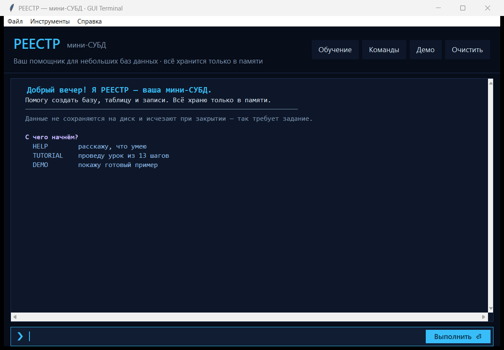
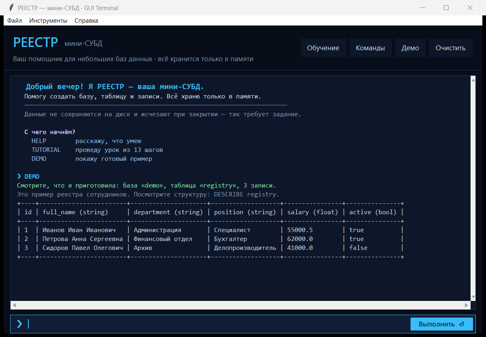
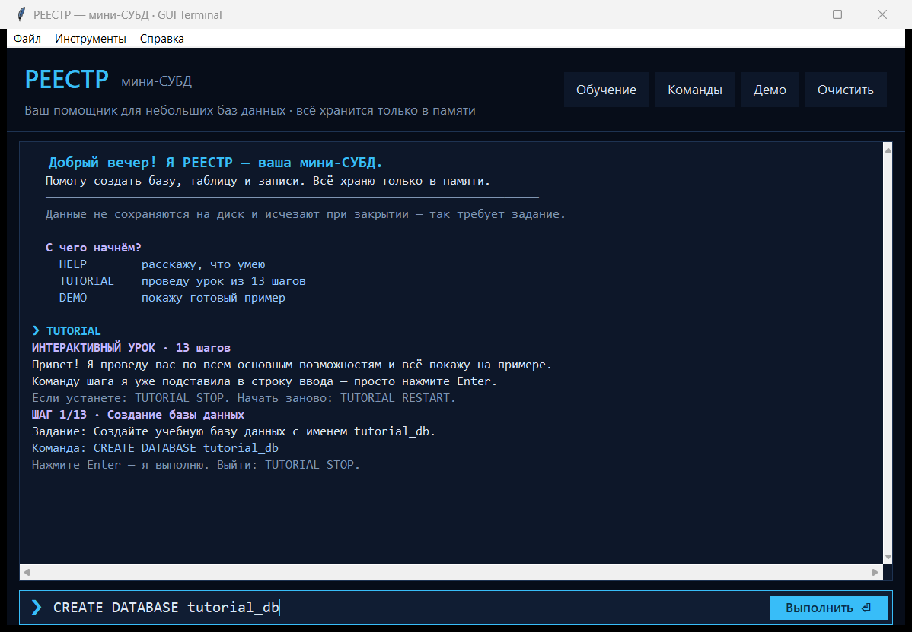
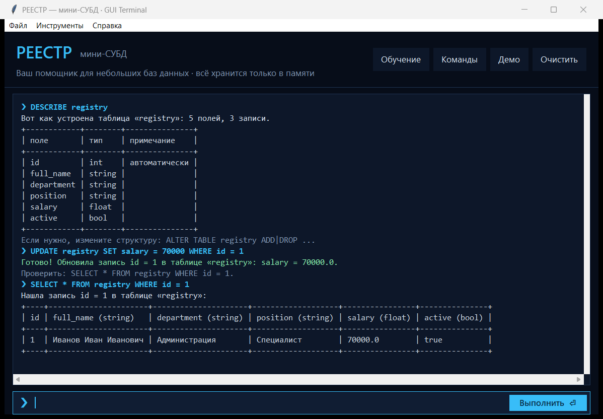
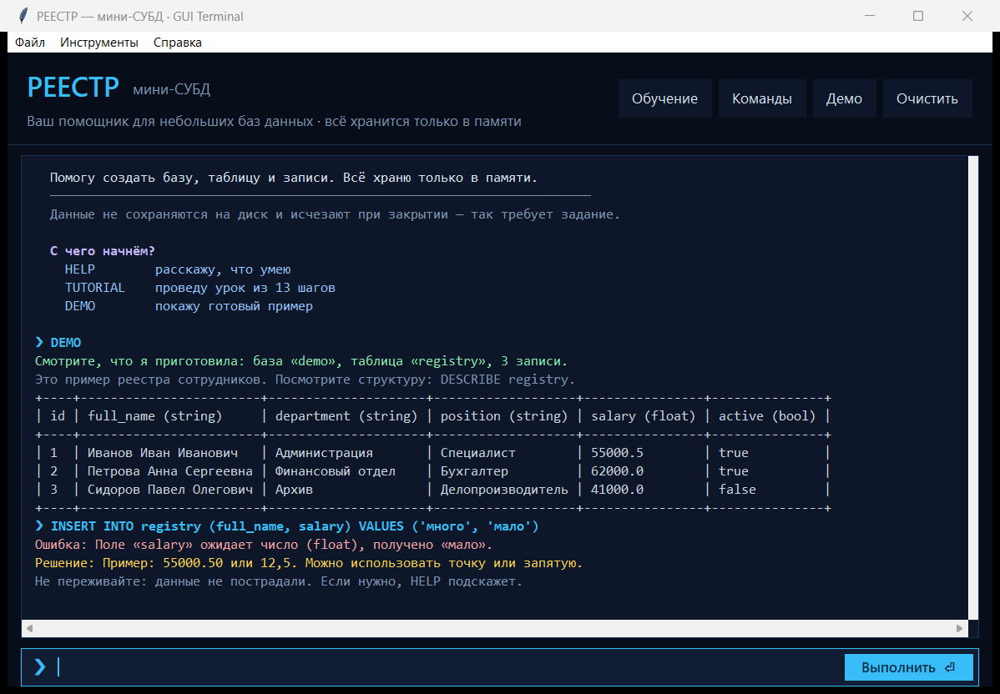

# Инструкция пользователя

## Приложение «РЕЕСТР» — учебная СУБД с GUI-терминалом

Версия 1.0

---

## 1. Общие сведения

«РЕЕСТР» — учебная система управления базами данных для внутреннего
использования. Приложение позволяет создавать базы данных и таблицы,
описывать поля, добавлять и изменять записи, не используя сторонние СУБД и
библиотеки.

### 1.1. Назначение

Приложение предназначено для ведения простых реестров и справочников:
сотрудников, подразделений, документов, оборудования и любых других
табличных данных.

### 1.2. Возможности

* создание баз данных с уникальными именами;
* просмотр списка баз и выбор текущей базы;
* создание таблиц с уникальными именами;
* поля четырёх типов: `string`, `int`, `float`, `bool`;
* просмотр списка таблиц и структуры таблицы;
* добавление и удаление полей;
* добавление записей, просмотр, изменение и удаление по `id`;
* проверка типов и понятные сообщения об ошибках с решением;
* интерактивный урок по всем возможностям системы;
* демонстрационная база с примерами;
* работа без установки сторонних пакетов.

### 1.3. Требования к компьютеру

| Параметр | Значение |
|---|---|
| Операционная система | Windows 10/11, Linux, macOS |
| Python | 3.10 или новее |
| Дополнительные пакеты | не требуются |
| Модуль GUI | `tkinter` (входит в стандартную поставку Python) |
| Объём памяти | достаточно 100 МБ свободной ОЗУ |

> **Важно.** Все данные хранятся только в оперативной памяти. При закрытии
> приложения базы, таблицы и записи удаляются. Это требование учебного
> задания, а не ошибка.

---

## 2. Запуск приложения

### 2.1. Способ 1 — командная строка

1. Откройте папку с проектом.
2. Запустите команду:

```powershell
python main.py
```

### 2.2. Способ 2 — без окна консоли

Дважды щёлкните файл `run.pyw`. Откроется только главное окно приложения.

### 2.3. Первый запуск

После запуска появляется главное окно с краткой справкой и строкой ввода.
Введите одну из команд:

* `HELP` — список всех команд;
* `TUTORIAL` — интерактивный урок;
* `DEMO` — демонстрационная база с примерами.



---

## 3. Обзор интерфейса

Интерфейс выполнен в виде терминала:

1. **Заголовок** — название приложения и подсказка о хранении данных в RAM.
2. **Кнопки быстрого доступа**: «Обучение», «Команды», «Демо», «Очистить».
3. **Меню**: «Файл», «Инструменты», «Справка».
4. **Область вывода** — результаты команд, таблицы, ошибки и подсказки.
   Прокручивается вертикально и горизонтально.
5. **Строка ввода** — сюда вводится команда. Слева расположен символ `❯`.
6. **Кнопка «Выполнить»** — выполняет введённую команду.
7. **Строка состояния** — текущая база, количество таблиц и записей.

Цвета помогают ориентироваться:

| Цвет | Значение |
|---|---|
| голубой | заголовки, команды, приглашение |
| зелёный | успешная операция |
| красный | ошибка |
| жёлтый | предупреждение или решение проблемы |
| серый | пояснение |
| фиолетовый | шаг интерактивного урока |

### 3.1. Клавиши и мышь

| Действие | Результат |
|---|---|
| `Enter` | выполнить команду |
| `↑` / `↓` | предыдущая / следующая команда из истории |
| `Tab` | автодополнение команды |
| `F1` | справка |
| `Ctrl+L` | очистить экран |
| правая кнопка мыши | копировать выделенный текст |
| `Ctrl+C` в окне вывода | скопировать выделение |

---

## 4. Быстрый старт

Самый быстрый способ увидеть возможности — команда `DEMO`.

1. Введите `DEMO` и нажмите `Enter`.
2. Приложение создаст базу `demo`, таблицу `registry` и три записи.
3. На экране появится таблица сотрудников.



После этого можно попробовать команды:

```text
DESCRIBE registry
SELECT * FROM registry
UPDATE registry SET salary = 70000 WHERE id = 1
DELETE FROM registry WHERE id = 3
```

---

## 5. Интерактивный урок

Команда `TUTORIAL` запускает урок из 13 шагов. Он охватывает все основные
операции:

1. создание базы данных;
2. выбор базы;
3. создание таблицы;
4. просмотр структуры;
5. изменение структуры — добавление поля `email`;
6. добавление первой записи;
7. добавление второй записи;
8. просмотр данных;
9. изменение записи по `id` (оклад и email);
10. удаление записи по `id`;
11. финальная проверка;
12. удаление таблицы;
13. удаление базы данных.



На каждом шаге:

* показывается цель и готовая команда;
* команда автоматически подставляется в строку ввода;
* достаточно нажать `Enter`;
* урок проверяет фактическое состояние данных;
* при ошибке выводится подсказка, шаг не засчитывается.

Управление уроком:

| Команда | Действие |
|---|---|
| `TUTORIAL` | начать урок или показать текущий шаг |
| `TUTORIAL STOP` | остановить урок |
| `TUTORIAL RESTART` | начать заново, учебная база пересоздаётся |

Во время урока разрешены `HELP`, `STATUS`, `CLEAR`, `ABOUT` и команды урока.
Остальные команды блокируются, чтобы не разрушить учебные данные.

---

## 6. Работа с базами данных

### 6.1. Создание базы

```text
CREATE DATABASE demo
```

Имя должно начинаться с буквы или `_`, содержать буквы, цифры и `_`, длина —
до 32 символов. Регистр не важен: `demo` и `DEMO` — одна и та же база.
Первая созданная база автоматически становится текущей.

### 6.2. Список баз

```text
SHOW DATABASES
```

Выводится список с отметкой `*` у текущей базы, количеством таблиц и записей.

### 6.3. Выбор базы

```text
USE demo
```

Все операции с таблицами выполняются в текущей базе. Если база не выбрана,
приложение попросит создать или выбрать её.

### 6.4. Удаление базы

```text
DROP DATABASE demo CONFIRM
```

Требуется слово `CONFIRM`, потому что удаляются все таблицы и записи. Если
удалена текущая база, текущая база сбрасывается.

---

## 7. Работа с таблицами

### 7.1. Создание таблицы

```text
CREATE TABLE employees (name:string, age:int, salary:float, active:bool)
```

Правила:

* имя таблицы уникально в пределах базы;
* имя поля уникально в пределах таблицы;
* имя `id` зарезервировано: идентификатор создаётся автоматически;
* типы полей: `string`, `int`, `float`, `bool`;
* до 32 полей в таблице.

### 7.2. Список таблиц

```text
SHOW TABLES
```

Показывает таблицы, количество полей и записей.

### 7.3. Структура таблицы

```text
DESCRIBE employees
```



### 7.4. Добавление поля

```text
ALTER TABLE employees ADD email:string
```

Новое поле появится у всех записей со значением `—`. Заполнить его можно
командой `UPDATE`.

### 7.5. Удаление поля

```text
ALTER TABLE employees DROP email
```

Нельзя удалить последнее поле таблицы. Значения удалённого поля исчезают у
всех записей.

### 7.6. Удаление таблицы

```text
DROP TABLE employees CONFIRM
```

---

## 8. Работа с данными

### 8.1. Добавление записи

```text
INSERT INTO employees (name, age, salary, active)
VALUES ('Иван Петров', 30, 55000.50, true)
```

Все поля таблицы обязательны. Значения строк с пробелами, запятыми и скобками
заключаются в одинарные или двойные кавычки.

Можно перечислить значения по порядку полей:

```text
INSERT INTO employees VALUES ('Анна Смирнова', 27, 62000, false)
```

Система сама присваивает уникальный `id` и выводит его.

### 8.2. Просмотр записей

```text
SELECT * FROM employees
SELECT * FROM employees WHERE id = 1
```

Первая команда выводит все записи, вторая — одну запись по идентификатору.
Допускается короткая форма `SELECT employees`.

### 8.3. Изменение записи

```text
UPDATE employees SET salary = 60000, active = true WHERE id = 1
```

Изменять можно одно или несколько полей. Обязательно указывается `WHERE id`.
Идентификатор изменить нельзя.

### 8.4. Удаление записи

```text
DELETE FROM employees WHERE id = 2
```

Удаление выполняется только по `id`. Номера удалённых записей не
переиспользуются.

---

## 9. Типы данных и проверка значений

| Тип | Что принимает | Примеры | Что будет ошибкой |
|---|---|---|---|
| `string` | любую строку | `'Иван'`, `'Отдел кадров'`, `''` | — |
| `int` | целое число | `42`, `-7`, `0` | `1.5`, `abc`, пусто |
| `float` | число с точкой или запятой | `55000.50`, `12,5`, `-0.25` | `много`, `1.2.3` |
| `bool` | логическое значение | `true`, `false`, `1`, `0`, `да`, `нет` | `может быть`, `2` |

При неверном значении запись не добавляется или не изменяется, а пользователь
получает сообщение с примером правильного ввода.



---

## 10. Ошибки и способы их решения

| Сообщение | Причина | Что сделать |
|---|---|---|
| «База данных уже существует» | имя занято | выбрать другое имя или `USE <имя>` |
| «База данных не найдена» | опечатка в имени | `SHOW DATABASES`, затем `USE <имя>` |
| «Сначала выберите базу данных» | не выбрана текущая база | `CREATE DATABASE <имя>` или `USE <имя>` |
| «Таблица уже существует» | имя занято | другое имя или `DROP TABLE ... CONFIRM` |
| «В базе нет таблицы» | опечатка | `SHOW TABLES` |
| «Поле уже существует» | дубликат поля | другое имя или `ALTER TABLE ... DROP ...` |
| «Имя поля id зарезервировано» | попытка создать `id` | не указывать `id`, он создаётся сам |
| «Неизвестный тип данных» | например, `text` | `string`, `int`, `float`, `bool` |
| «Не заполнены поля» | пропущены значения | `DESCRIBE <таблица>` и заполнить все поля |
| «Нет поля» | опечатка в имени поля | `DESCRIBE <таблица>` |
| «Поле указано дважды» | повтор в `INSERT`/`UPDATE` | перечислить поле один раз |
| «Ожидает целое число» | `1.5` или текст в `int` | ввести целое число |
| «Ожидает число (float)» | текст или две точки | `55000.50` или `12,5` |
| «Ожидает логическое значение» | `2`, `может быть` | `true/false`, `1/0`, `да/нет` |
| «Запись с id не найдена» | неверный id | `SELECT * FROM <таблица>` и взять id из вывода |
| «Требуется подтверждение» | нет `CONFIRM` | добавить `CONFIRM` в конец команды |
| «Не закрыта кавычка» | нет закрывающей кавычки | добавить `'` или `"` |
| «Не закрыта скобка» | нет `)` | проверить парность скобок |
| «Команда не распознана» | опечатка | `HELP` |

После каждой ошибки выводится строка **«Решение: …»** с конкретным действием.

---

## 11. Справка в приложении

| Команда | Раздел |
|---|---|
| `HELP` | все команды |
| `HELP DB` | базы данных |
| `HELP TABLES` | таблицы |
| `HELP DATA` | записи |
| `HELP TYPES` | типы данных |
| `HELP ERRORS` | ошибки и решения |
| `HELP TUTORIAL` | обучение |
| `STATUS` | текущая база и размер |
| `ABOUT` | сведения о программе |
| `CLEAR` | очистить экран |
| `EXIT` | выход |

### 11.1. Дружелюбное общение

Программа не только выполняет команды, но и общается по-человечески:

| Команда | Что произойдёт |
|---|---|
| `ПРИВЕТ` | программа поздоровается и предложит, с чего начать |
| `СПАСИБО` | ответит «Пожалуйста» и напомнит про `HELP` |
| `КАК ДЕЛА` | коротко расскажет о своём состоянии |

Сообщения об успехе тоже понятные и живые: «Готово!», «Записал!»,
«Отлично! Шаг готов». Если что-то не получилось, программа пишет
«Ошибка», «Решение» и добавляет: «Не переживайте: данные не пострадали».

---

## 12. Проверочный сценарий

Выполните команды по порядку — это проверка всех основных возможностей:

```text
CREATE DATABASE test
CREATE TABLE products (title:string, price:float, quantity:int, available:bool)
DESCRIBE products
INSERT INTO products (title, price, quantity, available)
VALUES ('Ноутбук', 79999.90, 5, true)
INSERT INTO products (title, price, quantity, available)
VALUES ('Монитор', 24990, 12, true)
SELECT * FROM products
UPDATE products SET price = 23990 WHERE id = 2
SELECT * FROM products WHERE id = 2
ALTER TABLE products ADD vendor:string
UPDATE products SET vendor = 'Samsung' WHERE id = 2
DESCRIBE products
DELETE FROM products WHERE id = 1
SELECT * FROM products
DROP TABLE products CONFIRM
DROP DATABASE test CONFIRM
```

Если все команды выполнены без ошибок, приложение работает корректно.

---

## 13. Ограничения

* данные не сохраняются между запусками;
* нет импорта и экспорта файлов;
* нет транзакций, внешних ключей и SQL-джойнов;
* изменение и удаление записей — только по `id`;
* один пользователь, без сети и разграничения прав;
* строки длиннее 36 символов в таблице сокращаются в выводе, но хранятся
  полностью.

---

## 14. Частые вопросы

**Почему после закрытия пропали данные?**
По требованию задания данные хранятся только в оперативной памяти.

**Можно ли использовать русские имена?**
Да, имена баз, таблиц и полей могут содержать русские буквы.

**Как узнать id записи?**
Выполните `SELECT * FROM <таблица>` — первый столбец содержит `id`.

**Почему нельзя изменить запись без `WHERE id`?**
Чтобы исключить случайное изменение всех записей сразу.

**Что делать, если допустил ошибку в команде?**
Прочитать строку «Решение», исправить команду и повторить. История команд
доступна по клавише `↑`.

**Как сбросить всё?**
Меню «Файл» → «Сбросить все данные» либо закройте и снова откройте
приложение.
