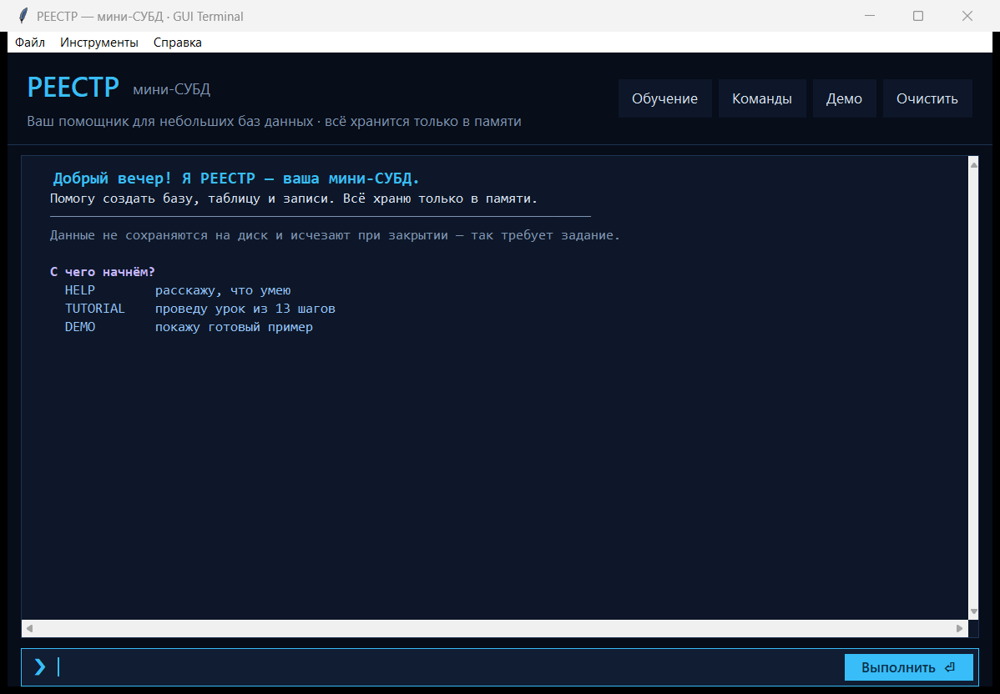
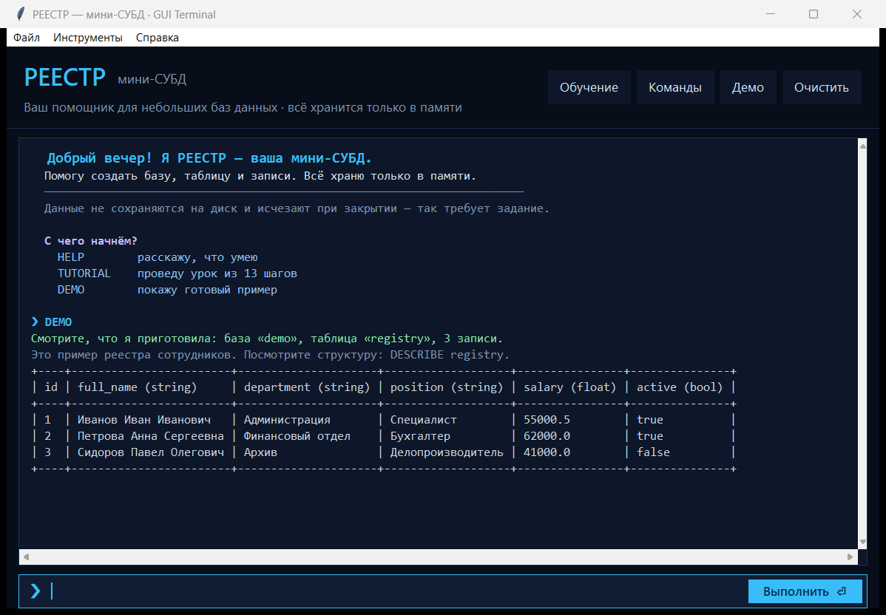
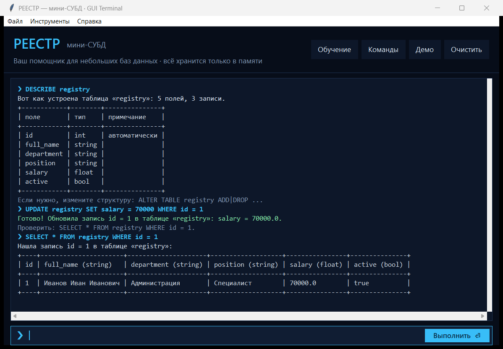
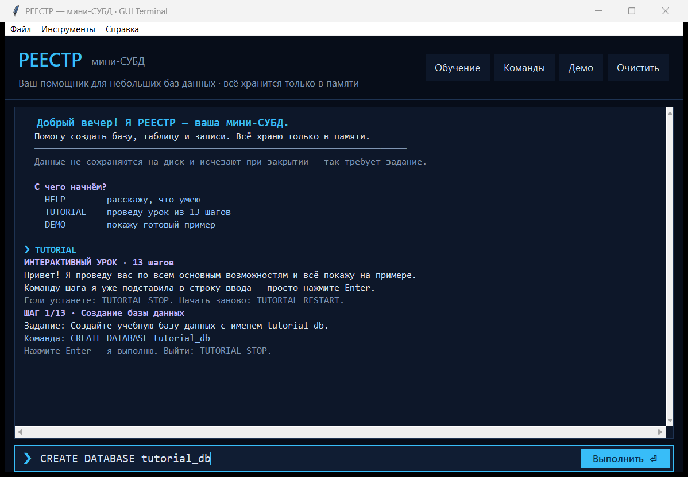
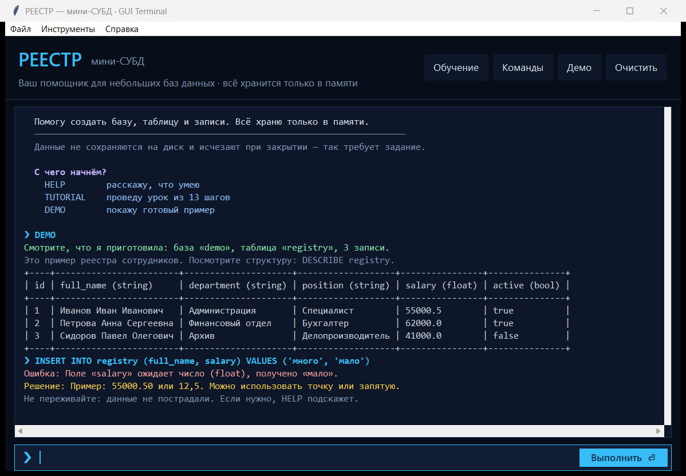
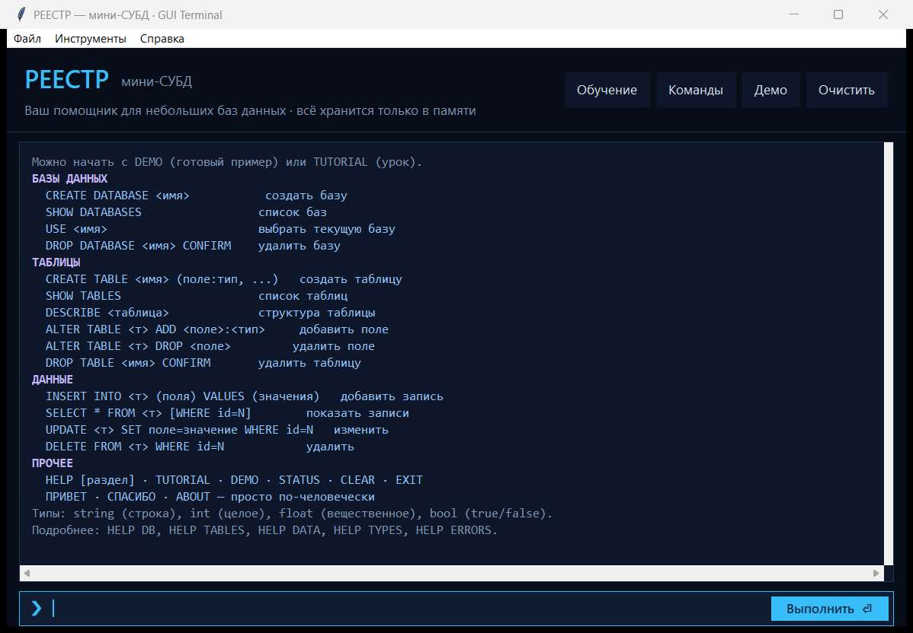

# ВВЕДЕНИЕ

Современные государственные и коммерческие организации ведут большое
количество реестров и справочников. Для работы с ними обычно используются
полноценные системы управления базами данных, однако в закрытых контурах
развёртывание стороннего программного обеспечения часто невозможно из-за
требований информационной безопасности.

В рамках учебной практики требовалось разработать упрощённую систему
управления базами данных, которая работает в изолированной среде, хранит
данные только в оперативной памяти и не использует внешние библиотеки.
Дополнительно требовалось реализовать GUI-терминал, интерактивное обучение и
корректную обработку пользовательских ошибок.

**Цель работы** — разработать учебную СУБД «РЕЕСТР» с графическим
терминалом, поддерживающую базы данных, таблицы, поля и записи.

Для достижения цели решались задачи:

1. проанализировать функциональные требования и требования к интерфейсу;
2. спроектировать модель данных и командный язык;
3. реализовать хранение данных в оперативной памяти;
4. реализовать проверку типов и обработку ошибочных ситуаций;
5. разработать GUI-терминал на tkinter;
6. реализовать интерактивный урок по всем возможностям системы;
7. подготовить автоматические тесты и документацию.

**Объект разработки** — процесс ведения табличных реестров. **Предмет
разработки** — приложение для создания и сопровождения баз данных в
оперативной памяти.

Практическая значимость работы состоит в том, что приложение можно
использовать для демонстрации принципов устройства СУБД, обучения работе с
таблицами и ведения небольших справочников без установки стороннего
программного обеспечения.

# 1 АНАЛИЗ ЗАДАНИЯ

## 1.1 Назначение системы

Заказчик — государственное ведомство, которому нужна упрощённая система
управления данными для внутреннего использования. Ведомство работает с
различными реестрами и справочниками, но не может развернуть полноценную
СУБД из-за требований информационной безопасности и ограничений на
использование стороннего программного обеспечения.

Система должна позволять создавать независимые базы данных, описывать в них
таблицы с полями разных типов, добавлять и сопровождать записи. Все данные
размещаются только в оперативной памяти: после закрытия приложения они
удаляются.

## 1.2 Функциональные требования

Анализ задания позволил выделить три группы требований.

**Работа с базами данных:**

* создание базы данных с уникальным названием;
* просмотр всех существующих баз;
* выбор конкретной базы для работы.

**Работа с таблицами:**

* создание таблиц с уникальным названием;
* создание полей с указанием типа данных;
* поддержка типов `bool`, `int`, `string`, `float`;
* просмотр всех таблиц в виде списка;
* просмотр конкретной таблицы и её структуры;
* добавление и удаление полей;
* проверка корректности вводимых данных.

**Работа с данными:**

* добавление данных в выбранную таблицу;
* изменение отдельных полей по идентификатору записи;
* удаление данных по идентификатору записи.

## 1.3 Требования к интерфейсу и качеству

Интерфейс должен быть реализован в виде GUI-терминала, понятно отображать
информацию, быть интуитивным, выводить ошибки и предлагать решения проблем.
Также требуется интерактивное обучение по всем возможностям системы.

Дополнительно предъявляются требования к качеству: корректное отображение
данных, продуманная архитектура, комментарии к основным функциям и отсутствие
критических ошибок во время работы.

## 1.4 Ограничения

* работа в изолированной среде;
* хранение данных только в оперативной памяти;
* отсутствие внешних библиотек;
* редактирование и удаление записей только по идентификатору;
* один пользователь, без сетевого режима.

В качестве языка реализации выбран Python 3. Для графического интерфейса
используется модуль `tkinter`, входящий в стандартную библиотеку. Сторонние
пакеты не применяются.

# 2 ПРОЕКТИРОВАНИЕ СИСТЕМЫ

## 2.1 Архитектура приложения

Приложение разделено на четыре слоя:

1. **Модель данных** — классы `Field`, `Table`, `Database`,
   `DatabaseManager`.
2. **Разбор команд** — модуль `parser.py`, который учитывает кавычки,
   скобки, запятые и ключевые слова.
3. **Исполнитель команд** — класс `Engine`, который вызывает методы модели
   и формирует результат.
4. **Интерфейс** — класс `TerminalGUI` на tkinter.

Такое разделение даёт важное преимущество: `Engine` не зависит от `tkinter`,
поэтому команды можно проверять автоматическими тестами без запуска окна.
Модель, в свою очередь, не знает о текстовом вводе и занимается только
данными и их валидацией.

Схема взаимодействия:

```text
Пользователь
    │
    ▼
TerminalGUI (tkinter)
    │  строка команды
    ▼
Engine ─────────► Tutorial
    │  вызовы
    ▼
DatabaseManager → Database → Table → Field
    │
    ▼
CommandResult → TerminalGUI
```

## 2.2 Модель данных

Основные сущности:

* **Field** — поле таблицы: имя и тип;
* **Table** — таблица: список полей, словарь записей, счётчик `id`;
* **Database** — база данных: словарь таблиц;
* **DatabaseManager** — все базы и указатель на текущую.

Записи хранятся в словаре `rows`, где ключ — целочисленный `id`, а значение —
словарь «имя поля → значение». Идентификатор создаётся автоматически,
уникален в пределах таблицы и не переиспользуется после удаления. Это
упрощает изменение и удаление записей и исключает дубликаты идентификаторов.

Имена баз, таблиц и полей уникальны без учёта регистра. Для хранения
используется ключ в нижнем регистре, а исходное написание сохраняется для
вывода. Имя `id` зарезервировано.

## 2.3 Командный язык

Взаимодействие построено на SQL-подобных командах. Язык намеренно упрощён:
он не является настоящим SQL и не требует движка баз данных.

| Группа | Команды |
|---|---|
| Базы данных | `CREATE DATABASE`, `SHOW DATABASES`, `USE`, `DROP DATABASE` |
| Таблицы | `CREATE TABLE`, `SHOW TABLES`, `DESCRIBE`, `ALTER TABLE`, `DROP TABLE` |
| Данные | `INSERT INTO`, `SELECT`, `UPDATE`, `DELETE` |
| Служебные | `HELP`, `TUTORIAL`, `DEMO`, `STATUS`, `CLEAR`, `EXIT` |

Для опасных операций удаления требуется слово `CONFIRM`. Изменение и
удаление записей допускается только с условием `WHERE id = N`, чтобы
исключить случайное изменение всей таблицы.

Команды `INSERT` и `UPDATE` поддерживают строки в кавычках. Собственный
разбор позволяет правильно обрабатывать значения с пробелами, запятыми и
скобками, например `'Иванов, Иван'`.

## 2.4 Обработка ошибок

Все ожидаемые ошибки описываются классом `DBError`, который содержит текст
ошибки и подсказку с решением. Исполнитель перехватывает такие ошибки и
выводит две строки:

```text
Ошибка: Поле «salary» ожидает число (float), получено «мало».
Решение: Пример: 55000.50 или 12,5. Можно использовать точку или запятую.
```

Дополнительно перехватываются непредвиденные исключения, поэтому ни одна
команда не приводит к аварийному завершению приложения. Проверяются:

* дубликаты баз, таблиц, полей и колонок в одной команде;
* несуществующие базы, таблицы, поля и идентификаторы;
* неверные имена и зарезервированное имя `id`;
* несоответствие типов данных;
* пропущенные обязательные поля;
* незакрытые кавычки и скобки;
* неизвестные команды.

# 3 РЕАЛИЗАЦИЯ

## 3.1 Модель данных и менеджер

Класс `DatabaseManager` хранит словарь баз и имя текущей базы. Метод
`require_database()` возвращает текущую базу или поднимает ошибку с
подсказкой, как её выбрать. При удалении текущей базы указатель сбрасывается.

Класс `Database` отвечает за таблицы. Метод `create_table()` сначала
проверяет все поля во временном объекте, и только потом добавляет таблицу в
словарь. Благодаря этому при ошибке в одном поле не появляется частично
созданная таблица.

Класс `Table` реализует:

* `add_field()` и `drop_field()` — изменение структуры;
* `insert()` — проверку всех значений и присвоение `id`;
* `update()` и `delete()` — операции по идентификатору;
* `snapshot()` — записи в порядке возрастания `id`.

Значения преобразуются функцией `convert_value()`. Для `int` используется
регулярное выражение, для `float` допускаются точка и запятая, для `bool` —
набор `true/false`, `1/0`, `да/нет`. Строки сохраняются без изменений.

## 3.2 Разбор команд

Модуль `parser.py` содержит функции:

* `split_top_level()` — деление по запятым вне кавычек и скобок;
* `find_keyword()` — поиск `SET` и `WHERE` вне строковых литералов;
* `extract_parenthesized()` — извлечение содержимого скобок;
* `parse_literal()` — снятие кавычек и обработка escape-последовательностей;
* `split_assignment()` — разбор конструкции `поле = значение`.

Собственный разбор потребовался потому, что значения могут содержать
запятые и скобки, а стандартное деление строки привело бы к ошибкам.

## 3.3 Исполнитель команд

`Engine.execute()` выполняет полный цикл:

1. убирает точку с запятой в конце;
2. проверяет, не заблокирована ли команда интерактивным уроком;
3. определяет команду и вызывает соответствующий обработчик;
4. перехватывает `DBError` и формирует сообщение с решением;
5. передаёт результат в урок для проверки шага;
6. возвращает `CommandResult`.

Результат содержит список строк с типами оформления (`info`, `success`,
`error`, `hint`, `table`, `tutorial`), а также необязательную команду для
подстановки в строку ввода. GUI не анализирует текст, а только отображает
готовые строки нужным цветом.

Чтобы код было проще читать, тексты справки вынесены в `help_text.py`, а
отрисовка таблиц символами — в `render.py`. В `engine.py` остаётся только
логика команд.

## 3.4 Графический интерфейс

Интерфейс реализован как тёмный терминал:

* заголовок и кнопки быстрого доступа;
* меню «Файл», «Инструменты», «Справка»;
* область вывода с вертикальной и горизонтальной прокруткой;
* строка ввода с приглашением `❯`;
* кнопка «Выполнить»;
* строка состояния с текущей базой и количеством записей.

Поддерживаются история команд (`↑`/`↓`), автодополнение (`Tab`), очистка
(`Ctrl+L`), справка (`F1`) и копирование вывода через контекстное меню.
Размер окна подстраивается под разрешение экрана.

Сообщения сформулированы по-человечески: программа здоровается по времени
суток, использует правильные формы слов («1 запись», «2 записи»), отвечает на
`ПРИВЕТ`, `СПАСИБО` и `КАК ДЕЛА`, а после ошибки добавляет, что данные не
пострадали.

## 3.5 Интерактивный урок

Урок состоит из тринадцати шагов и описывается списком объектов `Step`.
Каждый шаг содержит:

* заголовок и задание;
* готовую команду;
* регулярное выражение для проверки команды;
* функцию проверки фактического состояния данных;
* подсказку.

После выполнения команды урок проверяет, достигнуто ли целевое состояние.
Например, на шаге изменения требуется, чтобы оклад записи `id = 1` стал
равен `60000`, а поле `email` заполнено. Если состояние не достигнуто, шаг
не засчитывается и выводится подсказка. Команда шага автоматически
подставляется в строку ввода, поэтому урок можно пройти, нажимая `Enter`.

В конце урока учебная таблица и база удаляются командами
`DROP TABLE ... CONFIRM` и `DROP DATABASE ... CONFIRM`.

Во время урока посторонние команды блокируются, чтобы не разрушить учебные
данные. Разрешены `HELP`, `STATUS`, `CLEAR`, `ABOUT` и команды управления
уроком.

# 4 ТЕСТИРОВАНИЕ

## 4.1 Методика

Использовано модульное тестирование стандартной библиотекой `unittest`.
Тесты работают с `Engine` напрямую, без графического интерфейса. Для каждого
теста создаётся чистое хранилище, поэтому тесты независимы.

Запуск:

```text
python -m unittest discover -s tests -v
```

## 4.2 Результаты автоматических тестов

Разработано 42 теста. Все тесты проходят успешно.

| Группа | Количество | Что проверяется |
|---|---:|---|
| Базы данных | 5 | создание, дубликаты, выбор, удаление, валидация имён |
| Таблицы и поля | 9 | создание, дубликаты, `id`, типы, `ALTER`, удаление |
| Записи и типы | 15 | вставка, пропуски, лишние поля, все типы, `UPDATE`, `DELETE` |
| Стабильность и справка | 9 | неизвестные команды, скобки, `HELP`, `DEMO`, `STATUS`, сброс |
| Интерактивный урок | 4 | полный проход, блокировка, остановка, `HELP` |

Отдельно проверяются:

* строки с запятыми и кавычками;
* вставка значений без списка полей;
* варианты `bool`: `true/false`, `1/0`, `да/нет`;
* добавление поля к таблице с записями (значение `—`);
* невозможность удалить последнее поле;
* отсутствие частично созданной таблицы при ошибке в поле;
* устойчивость к незакрытым скобкам и кавычкам.

## 4.3 Ручное тестирование

Проверены сценарии:

1. запуск приложения и отображение главного окна;
2. быстрый старт через `DEMO`;
3. полный проход интерактивного урока;
4. создание собственной базы и таблицы;
5. ввод неверного типа и получение подсказки;
6. дубликаты базы, таблицы и поля;
7. изменение и удаление записи по `id`;
8. удаление таблицы и базы с подтверждением;
9. очистка экрана, история команд, автодополнение;
10. закрытие приложения с предупреждением о потере данных.

Критических ошибок не выявлено.

# 5 РУКОВОДСТВО ПОЛЬЗОВАТЕЛЯ

Для запуска достаточно выполнить `python main.py` или открыть `run.pyw`.
После запуска доступны команды `HELP`, `TUTORIAL` и `DEMO`.

Типовой сценарий:

```text
CREATE DATABASE demo
CREATE TABLE employees (name:string, age:int, salary:float, active:bool)
INSERT INTO employees (name, age, salary, active)
VALUES ('Иван Петров', 30, 55000.50, true)
SELECT * FROM employees
UPDATE employees SET salary = 60000 WHERE id = 1
DELETE FROM employees WHERE id = 1
```

Подробная инструкция со всеми командами, типами данных, ошибками и
скриншотами приведена в документе «Инструкция пользователя».

# ЗАКЛЮЧЕНИЕ

В ходе работы разработано приложение «РЕЕСТР» — учебная СУБД с
GUI-терминалом. Реализованы все требования задания:

* создание и выбор баз данных;
* создание таблиц и полей четырёх типов;
* просмотр структуры и списка таблиц;
* добавление, изменение и удаление записей по `id`;
* проверка типов и обработка ошибочных ситуаций с подсказками;
* интерактивный урок по всем возможностям;
* графический интерфейс в виде терминала;
* хранение данных только в оперативной памяти без сторонних библиотек.

Архитектура разделена на модель, разбор команд, исполнитель и интерфейс, что
упрощает сопровождение и тестирование. Подготовлено 42 автоматических
тестов, все они проходят успешно.

Приложение можно использовать как учебный стенд для демонстрации принципов
работы СУБД и как основу для дальнейшего развития: сохранения данных в файл,
разграничения прав, расширенной выборки и экспорта отчётов.

# СПИСОК ИСТОЧНИКОВ

1. Python Software Foundation. The Python Standard Library [Электронный
   ресурс]. — URL: https://docs.python.org/3/library/ (дата обращения:
   20.11.2026).
2. Python Software Foundation. tkinter — Python interface to Tcl/Tk
   [Электронный ресурс]. — URL: https://docs.python.org/3/library/tkinter.html
   (дата обращения: 20.11.2026).
3. Дейт, К. Дж. Введение в системы баз данных / К. Дж. Дейт. — 8-е изд. —
   Москва : Вильямс, 2006. — 1328 с.
4. Кузнецов, С. Д. Основы баз данных / С. Д. Кузнецов. — 2-е изд. —
   Москва : Интернет-Университет информационных технологий, 2007. — 484 с.
5. ГОСТ 7.32-2017. Система стандартов по информации, библиотечному и
   издательскому делу. Отчёт о научно-исследовательской работе. Структура и
   правила оформления. — Москва : Стандартинформ, 2017.

# ПРИЛОЖЕНИЕ А. ПЕРЕЧЕНЬ КОМАНД

| Команда | Назначение |
|---|---|
| `CREATE DATABASE <имя>` | создать базу данных |
| `SHOW DATABASES` | список баз |
| `USE <имя>` | выбрать текущую базу |
| `DROP DATABASE <имя> CONFIRM` | удалить базу |
| `CREATE TABLE <имя> (поле:тип, ...)` | создать таблицу |
| `SHOW TABLES` | список таблиц |
| `DESCRIBE <таблица>` | структура таблицы |
| `ALTER TABLE <т> ADD <поле>:<тип>` | добавить поле |
| `ALTER TABLE <т> DROP <поле>` | удалить поле |
| `DROP TABLE <имя> CONFIRM` | удалить таблицу |
| `INSERT INTO <т> (поля) VALUES (значения)` | добавить запись |
| `SELECT * FROM <т> [WHERE id = N]` | показать записи |
| `UPDATE <т> SET поле = значение WHERE id = N` | изменить запись |
| `DELETE FROM <т> WHERE id = N` | удалить запись |
| `HELP [раздел]` | справка |
| `TUTORIAL` | интерактивный урок |
| `DEMO` | демонстрационная база |
| `STATUS` | состояние системы |
| `CLEAR` | очистить экран |
| `EXIT` | выход |

# ПРИЛОЖЕНИЕ Б. СКРИНШОТЫ













# ПРИЛОЖЕНИЕ В. РОЛИ КОМАНДЫ

| Участник | Роль | Ответственность |
|---|---|---|
| Студент 1 | Руководитель проекта, backend | модель данных, исполнитель команд, тесты |
| Студент 2 | Frontend-разработчик | GUI-терминал, оформление, скриншоты |
| Студент 3 | Аналитик, документовед | требования, инструкция, отчёт, презентация |

Перед сдачей необходимо указать фактический состав команды и распределение
обязанностей.
